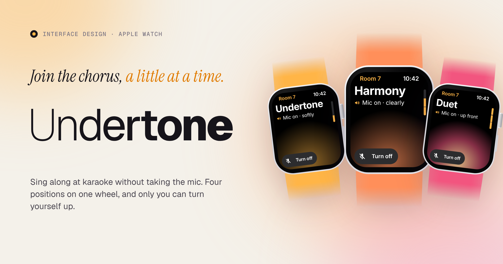
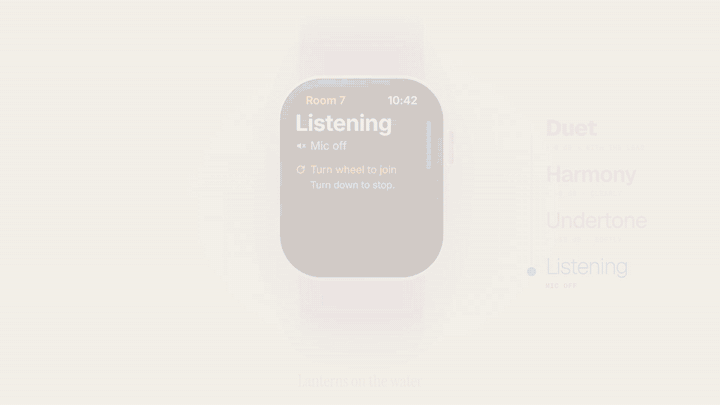
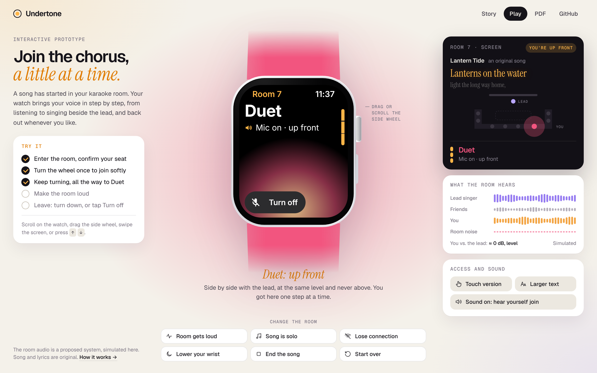
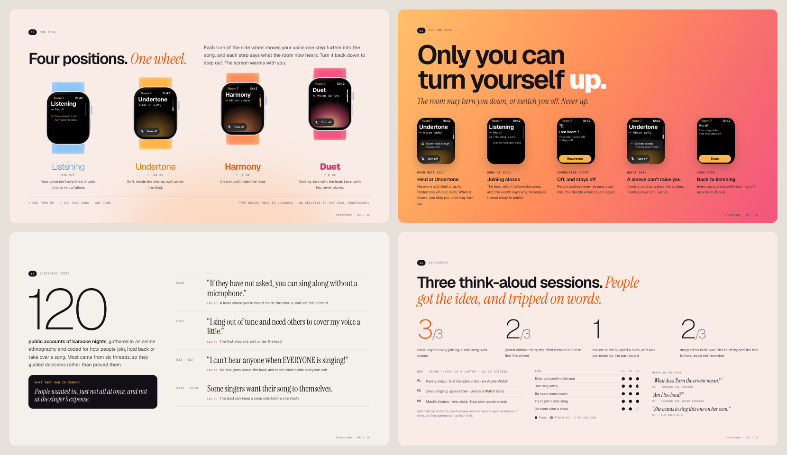

<p align="center"></p>

# Undertone

**Join the chorus, a little at a time.** At karaoke, joining a song usually means taking the mic. Undertone is an Apple Watch interface that lets you bring your voice in one turn of the side wheel at a time, from listening to singing beside the lead, and step back out whenever you like.

**[▶ Play the prototype](https://yulinhenryou.github.io/undertone/play/)** · **[Read the story](https://yulinhenryou.github.io/undertone/)** · [PDF](docs/undertone-case-study.pdf) · [Film](docs/assets/film/undertone.mp4)

Interface design · Apple Watch · 2026 · Henry Ou: research, interaction and visual design, prototyping, testing.

<p align="center"></p>

## The idea

Karaoke has two volumes: silent and spotlight. Undertone adds the ones in between.

| Position | What the room hears |
|---|---|
| **Listening** | Mic off. A valid choice, not a failure. |
| **Undertone** | Soft, inside the chorus, about 18 dB under the lead. |
| **Harmony** | Clearer, about 8 dB under the lead. |
| **Duet** | Side by side with the lead: level with her, never above. |

Each turn moves you one step; turn back down to step out. The screen warms with you, so your level reads from the corner of your eye.

It all rests on one rule: **only you can turn yourself up.** The room may turn you down or switch you off, never up.

- **Room gets loud** → anything above Undertone drops to Undertone. When it clears, you stay put and may turn up.
- **The lead keeps a song solo** → joining closes before she starts, and the watch says why.
- **Connection drops** → your mic switches off and stays off. Reconnecting never reopens it.
- **Wrist down** → turning up only wakes the screen; turning down still works.
- **Song ends** → mic off. Every song is a fresh choice.

The watch is one part of a **proposed** room audio system: a ceiling microphone array picks up only your seat and mixes you in at your level. It is simulated in the prototype; separating neighbouring voices is untested, and the dB values are provisional.

## Three ways in

| | What it is | Best for |
|---|---|---|
| **[The film](docs/assets/film/undertone.mp4)** | 34 seconds, no sound needed. The whole idea in one watch. | A first look |
| **[The prototype](https://yulinhenryou.github.io/undertone/play/)** | The real interaction in a browser: turn the wheel, change the room, hear yourself join. | Feeling it |
| **[The story](https://yulinhenryou.github.io/undertone/)** · [PDF](docs/undertone-case-study.pdf) | The design first, then backstage: research, sketches, cuts, testing, what changed. One page, also printed as 15 slides. | The reasoning |

### The prototype



- **Turn the wheel** by scrolling on the watch, dragging the side wheel, swiping the screen, or pressing ↑ / ↓.
- **Change the room**: make it loud, keep a song solo, drop the connection, lower your wrist, end the song.
- **Watch the room react**: the karaoke screen lights up an original song’s lyrics in time, your seat glows brighter as you turn up, and a meter shows what the room hears.
- **Hear it**: sound on, and your harmony line comes in under the lead as you turn.
- **Access**: a touch version (Join softly / Softer / Louder) and a larger-text example.
- Keys: `↑` `↓` level · `N` noise · `S` solo · `L` lost connection · `W` wrist · `E` end song · `T` touch · `Enter` primary action.

Plain HTML, CSS and JavaScript. No build step, no dependencies.

### The story



The design comes first (the moment, four positions, the rule, the screen, the room, access), then **Backstage**: what 120 karaoke stories said, the turn that gave control to the joiner, sketches, what was cut, three think-aloud sessions, and what changed after.

## What was tested, and what wasn’t

Three think-aloud sessions using the Figma player on a laptop: P1 and P2 on 21 October 2026, and P3 on 22 October. These sessions tested the course prototype, not the browser demo published here. All three participants could explain why joining a solo song was closed; two of three joined without help; one mouse scroll skipped a level. Four labels changed after testing. Pierre Pan’s later peer review asked for fewer screens and a clearer report; it was not another usability test. The participants were friends of mine, so their comments may lean kind.

**The current wheel-controlled Duet and stage light are post-test additions and are not yet tested.** Still open: how loud each level sounds to others, real wheel steps on a watch, whether friends recognise a voice, separating neighbouring voices, whether Duet should need the lead’s OK, and VoiceOver on a real watch. The desktop test shows the interface is understood, not that joining feels safer; that needs a real watch in a real karaoke room.

## Process notes

1. [Research](process/01-research.md): the earlier concept, the ethnography, who it’s for, the rule
2. [Sketches and iteration](process/02-sketches-and-iteration.md): five sketch sheets, every version, why Duet came back
3. [Usability testing](process/03-testing.md): plan, tasks, every session, results and changes
4. [Accessibility and design system](process/04-accessibility-and-design-system.md): contrast, WCAG status, touch version, VoiceOver labels
5. [References](process/references.md)

## Repository

```
docs/                  GitHub Pages site (publish from /docs)
  index.html           the story
  play/                the interactive prototype
  undertone-case-study.pdf
  assets/              watchkit.js (watch screens), app.js (prototype), story and site styles, fonts, images, film
design/
  screens/             every screen as a 2x PNG (history/ holds earlier versions)
  sketches/            the five hand-drawn sketch sheets
  flows/               user flows v1.0 to v1.3
process/               research, iteration, testing and accessibility notes
src/                   build script and templates (film, social image, screen exports)
```

**Open it locally:** double-click `docs/index.html` (story) or `docs/play/index.html` (prototype). Or run `python -m http.server -d docs` and visit http://localhost:8000.

**Rebuild the exports** (PDF, film, screens, images):

```bash
pip install playwright && python -m playwright install chromium   # ffmpeg is needed for the film
python src/build.py            # or: pdf · film · screens · images
```

## Credits and notes

- **Design and research.** Undertone is my original design, developed from an idea I began exploring during A2. I designed the flows, interfaces, copy and design system; drew the sketches; made the scope and design decisions; conducted reviews and real participant tests; and developed and checked the design, Figma file, report and appendix. Test participants are anonymised as P1–P3.
- **Tools and AI.** I used ChatGPT (OpenAI) for language editing and proofreading, some appendix formatting, and organising peer-feedback and participant records. Claude (Anthropic) was used to critique my own design, as documented in the process notes. Following my tutor’s seminar guidance, I used Figma AI to generate two karaoke-room scenes to explain the setting; one is shown here, colour-graded. I evaluated the feedback and retained responsibility for every design decision.
- **Images.** The photographic karaoke scene is AI-generated and the people in it are not real. The sketch sheets are my own hand-drawn design explorations.
- **Device frames** are drawn in SVG, not Apple product images. Apple Watch, watchOS and Digital Crown are trademarks of Apple Inc. This is an independent concept, not affiliated with Apple.
- **Type:** Geist, Geist Mono and Instrument Serif; Inter on the watch screens, standing in for SF Compact. All under the SIL Open Font License ([licences](docs/assets/fonts)).
- **Song and lyrics** in the prototype (“Lantern Tide”) are original.

## Licence

- **Code** (`docs/assets/*.js`, `src/`): [MIT](LICENSE)
- **Design and writing** (story, film, screens, sketches, process notes, images): [CC BY-NC 4.0](LICENSE-CONTENT.md)
- **Fonts:** SIL Open Font License 1.1
